<!--
  KANSO // DEEP FIELD
  Every image below is hand-built SVG: no GIFs, no JavaScript, text drawn as real glyph outlines.
  Artwork:   node scripts/build.mjs        (scripts/scenes/*.mjs)
  Telemetry: scripts/telemetry.mjs, refreshed daily by .github/workflows/telemetry.yml
  Previous README (to roll back): archive/2026-11-07-original/README.md  ·  git tag v1-original-readme
-->

<p align="center">
  
</p>

<p align="center">
  <a href="https://linkedin.com/in/mohamadkanso"></a>
  <a href="mailto:kanso1245@gmail.com"></a>
  <a href="https://mohamadkanso.github.io/hermes-contributions/"></a>
</p>

<p align="center">
  
</p>

<p align="center">
  
</p>

<details>
<summary><b>Read the briefing as code</b></summary>
<br/>

```python
class MohamadKanso:
    """Senior Forward Deployed AI Associate | Production AI Agents · LLM Systems · AI Governance"""

    role     = "Senior Forward Deployed AI Associate"
    company  = "7IM"
    location = "London, UK"
    degree   = "MSci Data Science, City, University of London (2:1)"

    stack = {
        "genai_llms" : ["LangChain", "RAG", "FAISS", "ChromaDB", "Ollama", "Whisper.cpp"],
        "ai_ml"      : ["PyTorch", "scikit-learn", "XGBoost", "LightGBM", "MLflow"],
        "data_cloud" : ["PySpark", "Databricks", "Azure Data Factory", "PostgreSQL"],
        "backend"    : ["Python", "Flask", "Docker", "GitHub Actions", "pytest"],
        "local_ai"   : ["Llama 3.2", "Qwen-2.5 3B", "sub-2s latency", "zero cloud"],
    }

    open_source = {
        "hermes_agent": "21 authored + 13 co-authored commits on main",
        "record"      : "mohamadkanso.github.io/hermes-contributions",
    }

    achievements = [
        "40% latency reduction across 50M-record Databricks pipelines",
        "80% cost reduction via a fully local LLM stack vs paid APIs",
        "First-Class dissertation (76%): BTC/USD time-series LSTM",
        "Computer Vision Challenge winner · Cognizant Vibe Challenge winner",
    ]

    def current_mission(self) -> str:
        return "Building & governing production AI agents @ 7IM"
```

</details>

<p align="center">
  
</p>

<p align="center">
  
</p>

<p align="center">
  <a href="https://mohamadkanso.github.io/hermes-contributions/"></a>
</p>

<p align="center">
  <a href="https://github.com/MohamadKanso/VoiceSafeKit"></a>
  <a href="https://github.com/MohamadKanso/CodeSentry"></a>
  <a href="https://github.com/MohamadKanso/MurmurX"></a>
  <a href="https://github.com/MohamadKanso/DreamSense"></a>
  <a href="https://github.com/MohamadKanso/IncidentForge"></a>
  <a href="https://github.com/MohamadKanso/WorkflowForge"></a>
  <a href="https://github.com/MohamadKanso/Dissertation"></a>
  <a href="https://github.com/MohamadKanso/trading-ml-research"></a>
</p>

<p align="center">
  
</p>

<p align="center">
  
</p>

<p align="center">
  
</p>

<p align="center">
  
</p>

<p align="center">
  
</p>

<p align="center">
  
</p>

<p align="center">
  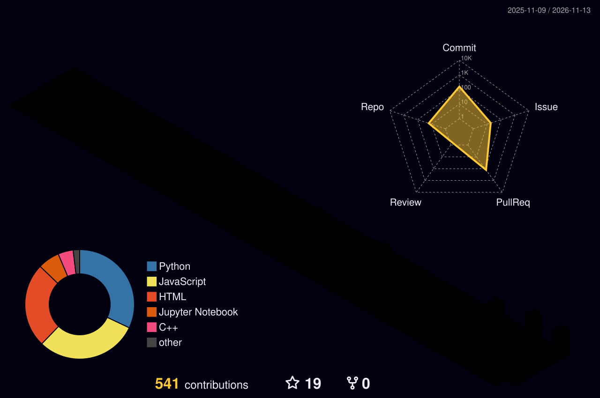
</p>

<p align="center">
  
</p>

<p align="center">
  
</p>
